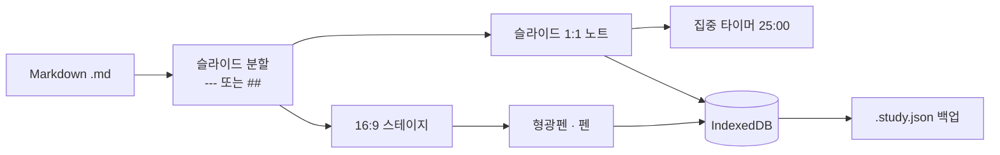

# Sága Glitra — 공부방 스튜디오

**Sága**는 노르드 신화의 지혜의 여신, **Glitra**는 반짝임입니다.  
마크다운으로 덱을 만들고, 슬라이드마다 노트를 붙여 공부합니다.

- 왼쪽 레일: 슬라이드 목록 · **미학습 / 복습 필요 / 이해 완료** 배지
- 가운데: 16:9 슬라이드 · 형광펜/펜 필기 · **가림막 암기**
- 오른쪽: 지금 보는 슬라이드에 1:1로 묶인 노트와 집중 타이머

> 이 덱은 지우지 않고 두어도 됩니다. `⋮ → 샘플 복원`으로 언제든 다시 부를 수 있습니다.

<!-- note:
첫 화면 사용법. 왼쪽 레일에서 슬라이드를 고르면 가운데 캔버스와 오른쪽 노트가 **같이** 넘어갑니다.
상단 `발표 모드(F5)`는 화면을 가득 채우고 ←/→ 로만 넘깁니다.
-->

---

## 1. 수식도 그대로 — $E = mc^2$

인라인 수식은 `$...$`, 블록 수식은 `$$...$$`로 적습니다.

$$
\int_{0}^{\infty} e^{-x^2}\,dx = \frac{\sqrt{\pi}}{2}
$$

| 개념 | 표기 | 뜻 |
| --- | --- | --- |
| 질량-에너지 | $E=mc^2$ | 질량은 에너지다 |
| 오일러 | $e^{i\pi}+1=0$ | 다섯 상수의 만남 |
| 정규분포 | $\frac{1}{\sigma\sqrt{2\pi}}e^{-\frac{(x-\mu)^2}{2\sigma^2}}$ | 흩어짐의 모양 |

<!-- note:
KaTeX가 번들에 들어 있어 오프라인에서도 수식이 깨지지 않습니다.
시험 직전에는 아래를 `==...==`로 감싸 가림막으로 바꿔 두세요.
-->

---

## 2. 코드 블록 — 언어 배지와 복사 버튼

```ts
type Slide = { id: string; title: string; markdown: string };

const splitDeck = (src: string): Slide[] =>
  src.split(/^---$/m).map((chunk, index) => ({
    id: `sl_${index}`,
    title: chunk.split('\n')[0].replace(/^#+\s*/, ''),
    markdown: chunk.trim(),
  }));
```

```bash
npm run build && npx vite preview --port 4173
```

- [x] 코드 블록 문법 강조
- [x] 체크리스트
- [ ] 남은 항목은 여기서 바로 확인

<!-- note:
코드 블록 오른쪽 위 `복사` 버튼은 클립보드에 그대로 넣습니다.
체크리스트는 노트에서도 똑같이 동작합니다.
-->

---

## 3. 구조는 Mermaid로



<!-- note:
Mermaid는 슬라이드를 열 때 그려집니다. 테마를 바꾸면 다이어그램도 함께 톤이 바뀝니다.
-->

---

## 4. 가림막 암기 — ==핵심만 가리고== 스스로 묻기

문장 안의 ==키워드==를 빈칸 가림막으로 바꿔 두면, 눌러서 하나씩 열어 볼 수 있습니다.

1. ==Sága==는 노르드 신화의 ==지혜의 여신==이다.
2. 슬라이드와 노트는 ==1:1==로 묶여 있다.
3. 필기는 ==IndexedDB==에 자동 저장된다.

상단의 `가막막 전체` 토글로 한 번에 숨기거나 열 수 있고,  
`발표 모드`에서는 ==←/→==로 넘기며 ==Esc==로 나옵니다.

<!-- note:
가림막은 `==이렇게==` 적습니다. 노트에서도 같은 문법이 됩니다.
스스로에게 질문을 먼저 던지고, 막혔을 때만 눌러서 확인하세요.
-->
